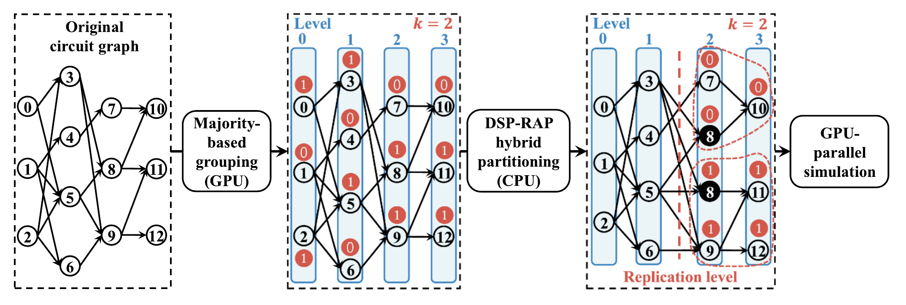

# SimPart

**Fast replication-aided circuit partitioning for GPU logic simulation**

[](https://doi.org/10.1007/978-3-031-99872-0_14)
[](LICENSE)
[](https://developer.nvidia.com/cuda-toolkit)

SimPart partitions a circuit graph for GPU-parallel logic simulation and
simulates it on the GPU. It replicates a small part of the circuit so that most
of the simulation runs in independent thread blocks, and it computes this
partition on the GPU in milliseconds instead of solving a hypergraph
partitioning problem.

This repository is the artifact of our Euro-Par 2025 paper
[*SimPart: A Simple Yet Effective Replication-Aided Partitioning Algorithm for
Logic Simulation on GPU*](https://doi.org/10.1007/978-3-031-99872-0_14)
([PDF](https://yi-huaaa.github.io/uploads/publications/2025-simpart-paper.pdf)).
It contains SimPart, the RepCut baseline it is compared with, and the scripts
that reproduce the experiments of the paper.

## Highlights

- **Millisecond partitioning on the GPU.** On the 12 benchmarks of the paper,
  SimPart partitions about 100× faster than RepCut with 16-thread Mt-KaHyPar.
- **Almost no replication.** At most 0.02% extra nodes (R|V| ≤ 1.0002),
  against up to 2.1% for RepCut (k = 16).
- **One CUDA graph per simulation.** All simulation passes run inside a single
  conditional (while-loop) CUDA graph.
- **Verified results.** `--verify` checks every simulation against a sequential
  CPU simulation.

Measured on an NVIDIA RTX A4000; see [results/](results/README.md) for the full
tables.

## Requirements

- An NVIDIA GPU and **CUDA 12.3 or newer** (for conditional CUDA graphs)
- CMake 3.24 or newer and a C++20 compiler with OpenMP that your CUDA version
  supports (for example GCC 12 with CUDA 12.3)
- Optional: [Mt-KaHyPar](https://github.com/kahypar/mt-kahypar) for the RepCut
  baseline, and Python 3 for the experiment scripts

## Quick start

```bash
git clone https://github.com/Yi-Huaaa/SimPart.git
cd SimPart
scripts/build.sh                                  # builds build/app/simpart
ctest --test-dir build --output-on-failure        # optional: unit tests
```

Partition and simulate a circuit that ships with the repository (218K gates,
1024 input patterns), and check the result against a sequential CPU simulation:

```bash
build/app/simpart benchmark/large_circuits/random3.ckt benchmark/large_circuits/random3.ptn --verify
```

```
SimPart 1.0.0 | GPU: NVIDIA RTX A4000 (sm_86)
circuit     random3.ckt: 218835 nodes, 414180 edges, 206 PIs, 107 POs
patterns    1024 patterns (16 rounds), files read in 17.6 ms
partitioner SimPart, k=16, gamma=1024
  time      3.361 ms (grouping 2.803 + hybrid 0.557), mean of 10 runs, std 0.171
  layout    58 levels: DSP [0, 33), RAP [33, 58) x 16 groups (3694 node instances)
  replication R|V| = 1.00000, R|E| = 1.00000
simulator   GPU, conditional CUDA graph, 4 rounds per pass (graph setup 1.015 ms)
  time      0.974 ms, mean of 10 runs, std 0.001
verify      PASSED (16 rounds x 107 POs, 218835 node values of the last round)
```

## How SimPart works



*Overview of SimPart with k = 2 and γ = 3. Node 8 is replicated across the two
RAP groups. From [Figure 2 of the paper](https://yi-huaaa.github.io/uploads/publications/2025-simpart-paper.pdf#page=5).*

1. **Majority-based grouping (GPU).** A level-by-level BFS over the circuit
   assigns each primary input the majority of `successor index mod k`, and each
   other node the majority group of its fanins. The same traversal levelizes the
   circuit.
2. **DSP-RAP hybrid partitioning (CPU).** Scanning back from the outputs, the
   first level with more than γ nodes is the *replication level*. Above it, the
   circuit is split into k fanin cones, one per group, and nodes shared by
   several cones are replicated (RAP: replication-aided partitioning). The
   levels up to the replication level stay disjoint and are simulated level by
   level over the whole GPU (DSP: disjoint set-based partitioning).
3. **GPU simulation.** Every pass, by default 4 rounds of 64 patterns, runs one
   kernel per DSP level and a single kernel for the RAP region, with one thread
   block per cone. All passes run inside one conditional (while-loop) CUDA graph.

## Usage

```
usage: simpart <circuit.ckt> <patterns.ptn> [options]

Partitioning
  -p, --partitioner NAME  simpart (default) or repcut
  -k, --partitions N      number of partitions k (default: 16)
  -g, --gamma N           SimPart replication threshold (default: 1024);
                          0 gives pure DSP, 'inf' gives pure RAP
  -t, --threads N         CPU threads of Mt-KaHyPar and the CPU simulator (default: 16)

Simulation
  -s, --simulator NAME    graph:  GPU, conditional CUDA graph (default)
                          stream: GPU, one stream launch per kernel
                          cpu:    CPU, OpenMP over the partitions
                          none:   partition only
  -b, --batch N           GPU: rounds of 64 patterns simulated per pass,
                          1, 2, 4 (default), 8 or 16

Measurement
  -r, --runs N            timed repetitions of partitioning and simulation (default: 10)
      --part-runs N       timed repetitions of partitioning (overrides --runs)
      --sim-runs N        timed repetitions of simulation (overrides --runs)
  -w, --warmup N          untimed warm-up repetitions before timing (default: 1)
      --part-warmup N     warm-up repetitions of partitioning (overrides --warmup)
      --sim-warmup N      warm-up repetitions of simulation (overrides --warmup)
      --verify            check the simulation results against a sequential CPU simulation
      --csv FILE          append the results as one CSV row to FILE
      --label NAME        benchmark name written to the CSV (default: circuit file name)
```

The input formats (`.ckt` circuits and `.ptn` bit-packed patterns) are described
in [benchmark/README.md](benchmark/README.md).

**Choosing k and γ.** k is the number of independent cones of the RAP region,
i.e. the number of thread blocks of the RAP kernel; the paper uses k = 16. γ
decides where the RAP region starts: a larger γ moves more levels into the RAP
region (fewer kernel launches, more replication), a smaller γ moves more levels
into the DSP region. The default γ = 1024 is the GPU block size. γ = 0 gives a
pure level-by-level (DSP) simulation and `inf` a pure replication-based (RAP)
one.

**Reported metrics.**

- *SimPart partitioning time* covers both partitioning stages: uploading the
  graph, grouping and levelizing it on the GPU, downloading the result, and
  building the hybrid partition. Reading the input files and creating the CUDA
  context are not included.
- *RepCut partitioning time* is the Mt-KaHyPar time; building its proxy
  hypergraph is reported separately.
- *Simulation time* is the time to simulate all pattern rounds. Building and
  instantiating the CUDA graph is a one-time cost, reported as "graph setup".
- *R|V|* and *R|E|* are the numbers of simulated nodes and fanin edges, replicas
  included, divided by the size of the circuit.

## Reproducing the paper

1. **Get the benchmarks.** The six circuits of the paper are too large for git.
   Put them in `benchmark/large_circuits/` and generate the larger `_eval`
   variants with `tools/scale_benchmark.py`, as described in
   [benchmark/README.md](benchmark/README.md).
2. **Build with the RepCut baseline.** RepCut needs
   [Mt-KaHyPar](https://github.com/kahypar/mt-kahypar) built as a library (see
   [Build options](#build-options)). Without it, everything else still works.
3. **Run the experiments.**

| Script | Experiment of the paper |
|---|---|
| `scripts/run_table2.sh` | Table 2: SimPart vs. RepCut on all 12 benchmarks |
| `scripts/run_fig6.sh` | Figure 6: partitioning time, simulation time and replication for k = 2 ... 128 |
| `scripts/run_fig7.sh` | Figure 7: simulation time for different replication thresholds γ |
| `scripts/run_fig8.sh` | Figure 8: simulation with and without the conditional CUDA graph |
| `scripts/run_all.sh` | all of the above |

Each script writes one CSV row per run to `results/local/<experiment>.csv`, keeps
the full output of every run in `results/local/logs/`, and prints a Markdown
table laid out like the paper at the end. To print it again, run
`scripts/summarize.py table2 results/local/table2.csv`. To run only some
benchmarks, pass their names: `scripts/run_table2.sh edit_dist netcard`.

The settings are environment variables; their defaults are the settings of the paper:

| Variable | Default | Meaning |
|---|---|---|
| `K` | 16 | number of partitions |
| `GAMMA` | 1024 | SimPart replication threshold γ |
| `BATCH` | 4 | rounds of 64 patterns per GPU simulation pass (`--batch`) |
| `RUNS` | 10 | timed repetitions of SimPart and of every simulation |
| `REPCUT_RUNS` | 3 | timed repetitions of RepCut partitioning (Mt-KaHyPar is slow) |
| `THREADS` | 16 | CPU threads of Mt-KaHyPar and of the CPU simulator |
| `BENCH_DIR` | `benchmark` | where the benchmarks are |
| `RESULTS_DIR` | `results/local` | where the results go |

For example: `GAMMA=2048 scripts/run_table2.sh netcard`. A full run of
`scripts/run_table2.sh` takes about 70 minutes on our machine, most of it in
single-threaded Mt-KaHyPar on the largest benchmarks.

Our results, and the machine and software versions they were measured with, are
in [results/](results/README.md).

## Build options

`scripts/build.sh` runs `cmake -S . -B build -DCMAKE_BUILD_TYPE=Release` and
`cmake --build build`; extra arguments are passed to CMake. Useful settings:

- **Compilers**: the standard CMake environment variables, e.g.
  `CUDACXX=/usr/local/cuda-12.3/bin/nvcc CXX=g++-12 CUDAHOSTCXX=g++-12 scripts/build.sh`.
- **GPU architecture**: defaults to the GPU of the build machine; set e.g.
  `-DCMAKE_CUDA_ARCHITECTURES=86` to build for another one.
- **Mt-KaHyPar** (RepCut baseline): found automatically if `libmtkahypar.so` and
  `libmtkahypar.h` are installed in a standard location; otherwise add its install
  prefix to `-DCMAKE_PREFIX_PATH`. We used Mt-KaHyPar v1.4-92-g39e06c75
  (September 2024); the C interface may differ in later releases. Pass
  `-DSIMPART_BUILD_REPCUT=OFF` to skip RepCut.
- **Tests**: `-DSIMPART_BUILD_TESTS=OFF` skips the unit tests. They check every
  partition against a sequential reference simulation, for several k and γ.

## Repository layout

```
simpart/      the library: circuit and pattern readers, levelization, partition data
              structure, SimPart (simpart.cu), RepCut (repcut.cpp), GPU and CPU simulators
app/          the simpart command-line tool
tests/        unit tests
scripts/      build and experiment scripts
tools/        benchmark conversion and generation
benchmark/    circuits and input patterns
results/      results of the experiments on our machine
3rd-party/    doctest (unit test framework)
```

## Citation

If you use SimPart in your research, please cite our paper:

```bibtex
@inproceedings{simpart2025,
  author    = {Chung, Yi-Hua and Jiang, Shui and Lee, Wan-Luan and Zhang, Yanqing and
               Ren, Haoxing and Ho, Tsung-Yi and Huang, Tsung-Wei},
  title     = {{SimPart}: A Simple Yet Effective Replication-Aided Partitioning
               Algorithm for Logic Simulation on {GPU}},
  booktitle = {Euro-Par 2025: Parallel Processing},
  series    = {Lecture Notes in Computer Science},
  volume    = {15902},
  pages     = {197--210},
  publisher = {Springer},
  year      = {2026},
  doi       = {10.1007/978-3-031-99872-0_14}
}
```

## Contact

For questions about SimPart, please email Yi-Hua Chung at
[yihua.chung@wisc.edu](mailto:yihua.chung@wisc.edu).

## License

SimPart is released under the [Apache License 2.0](LICENSE).
Copyright 2025 Yi-Hua Chung, Shui Jiang, Wan-Luan Lee, Yanqing Zhang, Haoxing Ren,
Tsung-Yi Ho, and Tsung-Wei Huang.

The bundled [doctest](https://github.com/doctest/doctest) header in `3rd-party/`
is under the MIT License.
